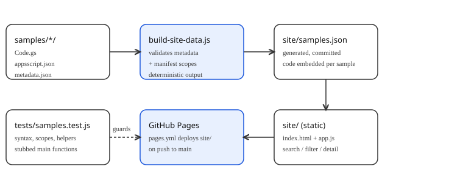

# Apps Script Samples

Live catalogue: https://enonymous1.github.io/apps-script-samples/

## Description

Small, working Google Apps Script samples you can copy into your own
script project, plus a dependency-free static site that catalogues
them with search, filtering, setup steps, OAuth scopes, and the full
source of each sample.

| Sample | Services | Level | What it does |
| --- | --- | --- | --- |
| Gmail Inbox Triage | Gmail | Beginner | Labels threads matching a search query, optionally archives them. Dry-run first. |
| Sheet Weekly Report | Sheets, Gmail | Intermediate | Counts data rows, optionally sums a column, emails the summary. |
| Drive File Organizer | Drive | Intermediate | Moves files into subfolders by type. Dry-run first. |
| Calendar Daily Agenda | Calendar, Gmail | Beginner | Emails tomorrow's events. Defaults to your own address. |

Design rules, applied to every sample:

- **Configuration lives in Script Properties, never in code.** No
  spreadsheet/folder IDs, no email addresses, no script IDs are
  hardcoded, so a sample can be shared and copied without leaking
  personal values.
- **Destructive samples dry-run by default.** Gmail triage and Drive
  organizer only log what they would do until `DRY_RUN` is set to
  `false`, because a wrong query or folder is the most likely mistake.
- **Scopes are the narrowest that work.** `gmail.send` where a sample
  only sends mail, `gmail.modify` where it labels or archives, and
  read-only Sheets and Calendar scopes where nothing is written.

## Prerequisites

- A Google account, for running a sample in the Apps Script editor.
- Node.js 20 or later, only for the tooling in this repo (tests, the
  site generator, and the local preview server). The samples
  themselves need no Node and no packages.
- Optional: [clasp](https://github.com/google/clasp) if you prefer
  pushing a sample from the command line instead of pasting it into
  the editor. The samples work either way.

No `npm install` step exists: this repo has zero runtime or
development dependencies, so there is no lockfile to maintain.

## Installation

```sh
git clone https://github.com/enonymous1/apps-script-samples.git
cd apps-script-samples
```

That is the whole installation. There is nothing to build before
browsing the samples, and nothing to install before running the
tests — Node's built-in test runner is used, with no test framework
dependency.

### Using a sample

1. Create a script project in the Apps Script editor (or run
   `clasp create`, then copy the sample's `.clasp.json.example` to
   `.clasp.json` and fill in your script ID). `.clasp.json` itself is
   gitignored, so a real script ID can never be committed by accident.
2. Copy the sample's `Code.gs` and `appsscript.json` into the project.
   Each sample is self-contained by design: there is no shared library
   to copy, because a cross-sample import would break the moment a
   reader copies one sample on its own.
3. Set its Script Properties (Project Settings > Script Properties).
   Each sample README lists its properties; required ones throw a
   clear error naming the property if they are missing.
4. Run its main function once, authorise only the scopes it declares,
   and check the execution log.
5. Only then set `DRY_RUN` to `false` (Gmail, Drive) or add a
   time-driven trigger (Sheets, Calendar).

## Local Development

```sh
npm test             # Node tests: manifests, scopes, syntax, helpers, stubbed main functions, site sync
npm run build:site   # regenerate site/samples.json from the samples
npm run preview      # serve site/ at http://localhost:8080/
```

### Architecture



The flow is deliberately one-directional: `samples/*/metadata.json`
plus `Code.gs` are the source of truth, `scripts/build-site-data.js`
validates them (required fields, difficulty, scope format, and that
manifest scopes match metadata scopes) and writes the deterministic
`site/samples.json`, and `site/app.js` renders that file. Nothing on
the site calls back into a sample, and nothing in a sample knows the
site exists, so either side can change without the other breaking —
except through the validated metadata contract, which is exactly what
the tests check.

### Adding a sample

1. Create `samples/<slug>/` with `Code.gs`, `appsscript.json`,
   `metadata.json`, `README.md`, and `.clasp.json.example`.
2. Keep it self-contained, configure it only through Script
   Properties, and default any destructive behaviour to dry-run.
3. Add helper tests (pure functions) and, where the main function
   matters, a stubbed-service test in `tests/samples.test.js` —
   v1.0.0's gap was that main functions were never run in tests at all.
4. Run `npm run build:site`, then `npm test`. The test suite fails
   if the generated site data drifts from the committed file.

## Deployment

The static site deploys itself: `.github/workflows/pages.yml`
publishes `site/` to GitHub Pages on every push to `main` (and can be
run manually from the Actions tab). The live site is at
https://enonymous1.github.io/apps-script-samples/.

If you fork this repo, two one-time steps are needed on your copy:

1. Settings > Pages > Source: GitHub Actions.
2. Set the repo's website field so the About box links to the site:
   `gh repo edit <owner>/<repo> --homepage https://<owner>.github.io/<repo>/`

CI (`.github/workflows/ci.yml`) runs the test suite on Node 20 and 22
across Ubuntu and Windows on pushes to `main` and on pull requests.
It does not deploy anything.

## Corrected Gmail reference

`docs/gmail-service.md` documents the real Apps Script `GmailApp` API
(`GmailApp.search()`, `thread.addLabel()`, `GmailApp.sendEmail()`).
It exists because the repository this project replaced contained a
Gmail explainer that listed Gmail REST API method names and linked
twice to the generic Gmail developer page.

## Verification status

Verified without a Google account: syntax, manifest/scope
consistency, helper logic, stubbed main-function behaviour, site/data
sync, and a local preview smoke test. The Pages site is live and was
checked directly (index and `samples.json` both return 200).

Still unverified, and still the owner's step: running each sample
against a real Gmail, Sheets, Drive, and Calendar account in the Apps
Script editor, including authorisation and time-driven triggers.

## License

MIT. See [LICENSE](LICENSE).
